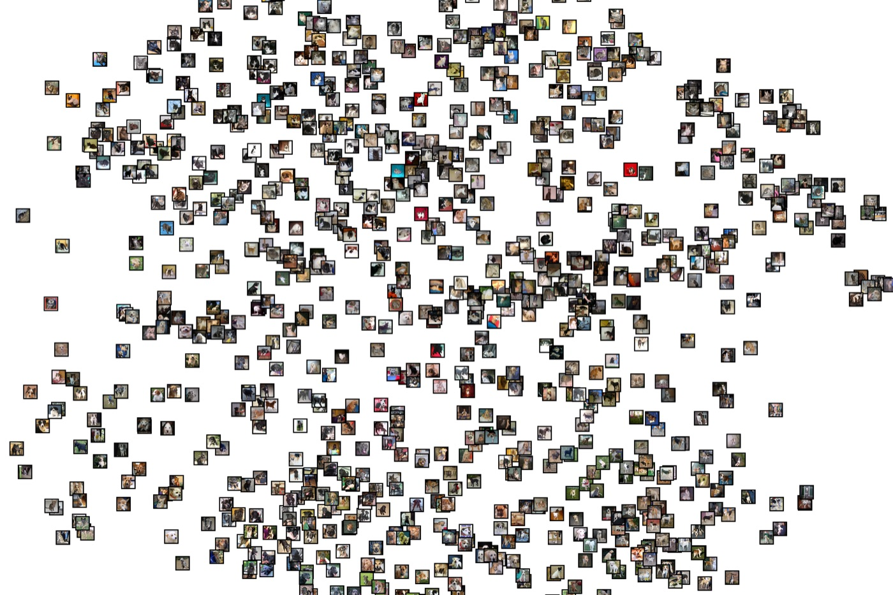
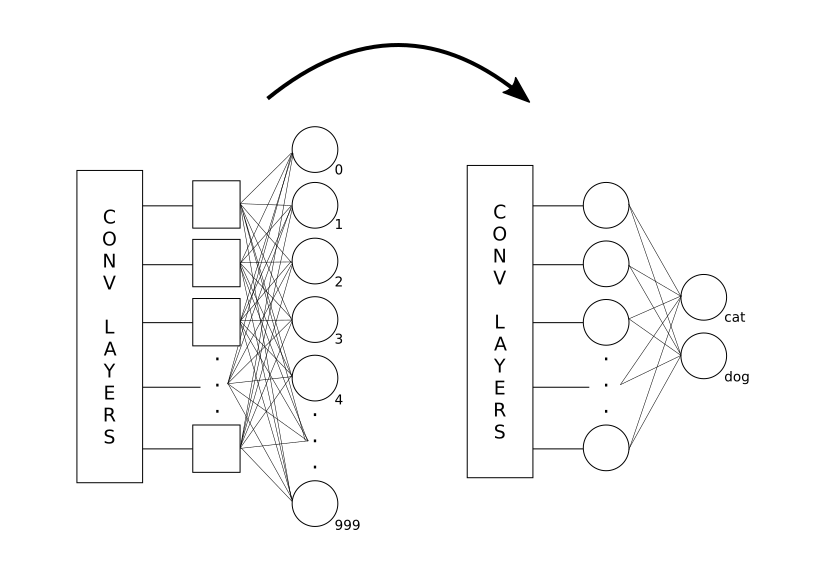
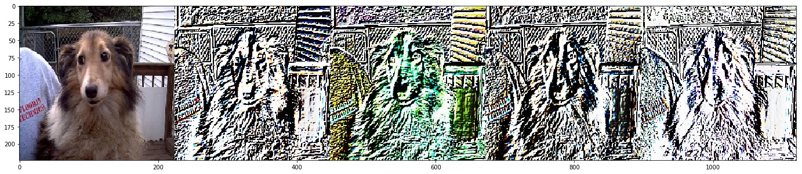
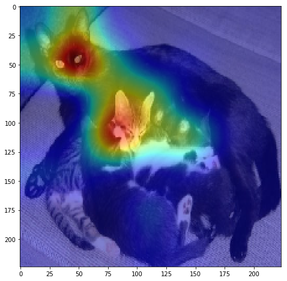
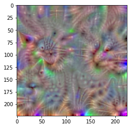
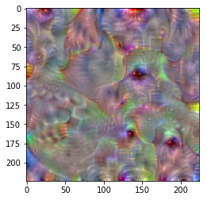

# Transfer learning com VGG16: gatos vs cachorros

Material de um tutorial de transfer learning preparado para o Deep Learning Summit, em 2018. Partindo de uma VGG16 pré-treinada na ImageNet, o tutorial treina só uma "cabeça" nova para separar gatos de cachorros. Depois abre a rede para mostrar o que ela aprendeu: filtros, padrões que maximizam neurônios, mapas de ativação de classe e uma projeção t-SNE do espaço de features.

*Fotos de gatos e cachorros posicionadas pela projeção t-SNE dos vetores da camada `fc1` do modelo treinado. Sem nenhum rótulo na projeção, os gatos se concentram na parte de cima e os cachorros na de baixo.*

## Roteiro do tutorial

O notebook principal é o [`Transfer Learning.ipynb`](Transfer%20Learning.ipynb), todo comentado em português.

### 1. O custo de treinar do zero

A VGG16 ([Simonyan & Zisserman, 2014](https://arxiv.org/abs/1409.1556)) tem 138.357.544 parâmetros. O treino de uma única rede levou 3 semanas em 4 GPUs NVIDIA GTX Titan Black. As três camadas densas do final concentram 89,36% desses parâmetros.

### 2. A rede convolucional como extratora de features

Para mostrar que a parte convolucional já serve de extratora de features genérica, o tutorial pega 3 keyframes de um vídeo, com um livro, um Raspberry Pi e um telefone, e calcula o vetor de saída de cada um. Em seguida mede, quadro a quadro, a distância euclidiana até esses vetores. A rede nunca foi treinada para reconhecer nenhum desses objetos, mas os quadros parecidos ficam próximos ([script](video/vector_for_frames.py)).

*Clique para ver a demonstração no YouTube. O vídeo também está em [`video/demo_transfer_learning.mp4`](video/demo_transfer_learning.mp4).*

### 3. Transfer learning: trocando a cabeça da rede

O classificador de 1.000 classes da ImageNet sai, e entram um global average pooling, uma camada densa de 32 neurônios e uma softmax de 2 classes. As camadas convolucionais ficam congeladas, então só as duas camadas novas são treinadas. O treino usa o dataset [Cats vs Dogs](https://www.microsoft.com/en-us/download/details.aspx?id=54765), com data augmentation, RMSprop e **uma única época**.

| Notebook | Imagens de treino | Validação | Acurácia de validação |
|---|---|---|---|
| `Transfer Learning.ipynb` | 5.600 | 1.400 | 96,1% |
| `Transfer Learningv2.ipynb` | 23.529 | 1.240 | 95,9% |

### 4. Olhando dentro da rede

**Filtros da primeira camada.** Aplicados direto numa foto, os filtros de `block1_conv1` respondem a bordas e cores, o que a rede aprendeu na ImageNet.

**Para onde a rede olha.** O mapa de ativação de classe (`visualize_cam`, do [keras-vis](https://github.com/raghakot/keras-vis)) destaca as regiões que mais pesaram para a predição "gato". Nesta imagem com vários gatos, a rede se concentra nas cabeças.

**O "gato" e o "cachorro" ideais.** A imagem é otimizada por gradiente ascendente para maximizar cada neurônio de saída. Neste exemplo, de um modelo com camada densa de 1.024 neurônios, aparecem texturas de pelo, olhos e focinhos.

 

*À esquerda, a imagem que maximiza o neurônio "gato"; à direita, a que maximiza o neurônio "cachorro".*

### 5. Visualizando o espaço de features

Os vetores da camada `fc1` passam por uma redução com SVD e depois por um t-SNE em 2 dimensões, e cada imagem é plotada na sua posição. A figura do topo deste README foi feita assim pelos notebooks `Generate Vector` e `TSNE`, com o modelo salvo em `data/`. A versão em alta resolução, de 10800×7200, está em [`data/tsne.png`](data/tsne.png).

## Arquivos

| Arquivo | O que tem |
|---|---|
| `Transfer Learning.ipynb` | O tutorial completo: VGG16, transfer learning, visualizações e t-SNE |
| `Transfer Learningv2.ipynb` | A mesma sequência, treinando com o dataset completo |
| `Infer + Class Maps.ipynb` | Inferência com o modelo salvo, mapas de ativação, saliência e filtros |
| `Generate Vector.ipynb`, `TSNE.ipynb` | Geram os vetores `fc1` de 5.000 imagens e a projeção t-SNE com as fotos |
| `split_files.ipynb` | Separa o dataset em pastas de treino e validação |
| `descorrompe_imgs.bash` | Apaga os arquivos do dataset que não são JPEG válidos |
| `convolution_intro/` | Introdução à convolução: um filtro detector de bordas aplicado com NumPy/SciPy |
| `video/` | Script e keyframes do experimento de distância entre vetores, e o vídeo final |
| `data/` | O modelo treinado (`.json` + `.h5`, com `fc1` de 1.024 neurônios), os vetores salvos e o t-SNE em alta resolução |

## Rodando

O código é de janeiro de 2018. Ele foi escrito para Python 3.5, Keras 2.0 com backend TensorFlow 1.x e [keras-vis](https://github.com/raghakot/keras-vis), além de scikit-learn, scikit-image, imageio e tqdm. Num ambiente atual, ele não roda sem adaptações: as APIs do Keras e do keras-vis mudaram desde então. Os caminhos de dados também estão fixos no código (`/home/sage/...`) e precisam ser ajustados.

Para reproduzir:

1. Baixe o dataset [Cats vs Dogs](https://www.microsoft.com/en-us/download/details.aspx?id=54765).
2. Rode `descorrompe_imgs.bash` dentro da pasta de imagens para remover os arquivos corrompidos.
3. Separe treino e validação com `split_files.ipynb`, na estrutura `train/{cat,dog}` e `val/{cat,dog}`.
4. Siga o `Transfer Learning.ipynb`.

## Licença

GPL-3.0, ver [LICENSE](LICENSE).
